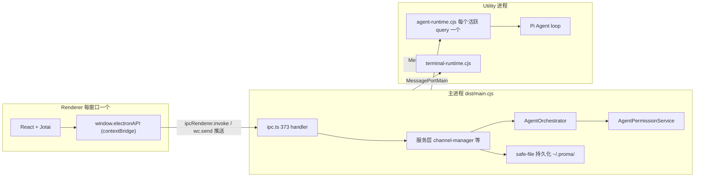
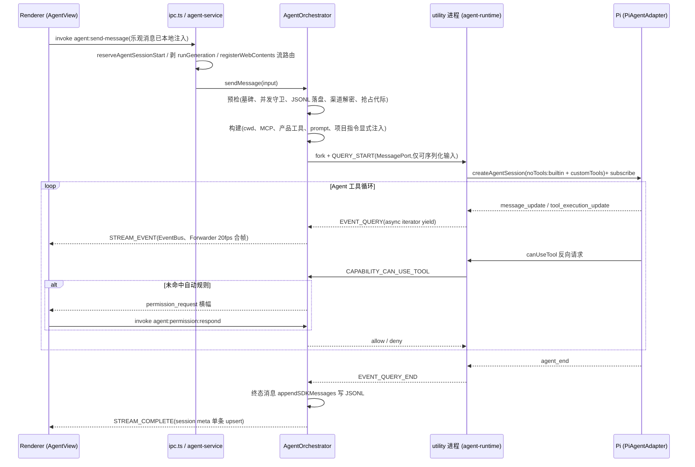
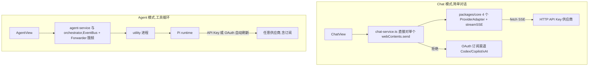

# Proma 架构解析

> 本文档基于 2026-11-06 对 `self-maintain` 分支(基线 `ff03a2c4`)的全仓代码调研整理,方法为四个分片并行探查(主进程、IPC 契约、renderer、packages 与构建)后交叉核实。文中行号与版本号是调研时快照,以当前代码为准。

## 概览

Proma 是本地优先的 Electron AI 桌面 Agent。它有两种工作模式。**Chat 模式**是传统多供应商对话界面,20+ provider 由 4 个协议适配器覆盖。**Agent 模式**是产品主干,基于外部 Pi coding agent SDK(`@earendil-works/pi-*` 0.87.1)的工具型 Agent,能读写文件、跑终端、控制受管浏览器、调用 MCP server 和内置产品工具(Todo/Automation/协作子 Agent 等)。围绕 Agent 核心,还长出了定时任务(Automations)、IM 桥接(飞书/钉钉/Slack/微信)、Skills 分发、macOS 灵动岛等周边能力。

架构上最重要的三个决定:

1. 业务状态与权限决策全部留在主进程,模型驱动的 Agent loop 跑在独立 Electron utilityProcess 里。默认每个活跃 query fork 一个进程,防止多个 Agent 抢占同一事件循环。
2. 所有用户数据落在 `~/.proma/` 的 JSON/JSONL 文件,用原子写封装保证崩溃安全。唯一例外是 planning.db 的 SQLite。
3. IPC 是四层手工同步的契约(shared 常量、main handler、preload bridge、renderer),运行时唯一保障是通道字符串匹配。

仓库是 Bun monorepo。主应用 `apps/electron`(调研时 v0.19.59),共享包 `packages/{shared,core,session-core,ui}` 全部 TS 源码直发、由消费方各自打包。

## 关键概念

- **Pi**:`@earendil-works/pi-coding-agent` / `pi-agent-core` / `pi-ai`,外部厂商的编码 Agent SDK,有自己的 SessionManager、ResourceLoader、SettingsManager、工具工厂。版本被根 `overrides` + 精确依赖 + `patches/` 三重锁死在 0.87.1。
- **SDKMessage**:Proma 内部事件协议,形状是 Claude Agent SDK 时代的遗产。Pi 迁移后故意不改名(`pi-agent-adapter.ts` 头注释),避免渲染层、Jotai、JSONL 持久化连带迁移。
- **AgentRuntimeClient / agent-runtime.cjs**:主进程与 utility 进程之间的属主与入口,MessagePortMain 双向 RPC,握手校验协议版本加 bootId 代际。
- **AgentOrchestrator**(`agent-orchestrator.ts`,2532 行):Agent 业务的全量编排。并发守卫、渠道解密、prompt 组装、canUseTool、事件循环与 JSONL 持久化。
- **AgentPermissionService / SAFE_TOOLS**:挂起式权限审批(Promise + Map)。`packages/shared/src/constants/permission-rules.ts` 的 SAFE_TOOLS 是免审批只读工具白名单。
- **runGeneration**:主进程内单调递增的运行代际,兼作 IPC 防乱序协议。renderer 侧另有 `startedAt` 作为 run 竞态标识。
- **safe-file 三件套**(`lib/safe-file.ts`):writeJsonFileAtomic、writeTextFileAtomic、readJsonFileSafe,备份、临时文件、改名式原子写。
- **ProviderAdapter**(`packages/core`):Chat 模式的 4 类协议适配器(Anthropic、OpenAI、OpenAIResponses、Google),纯逻辑构建请求与解析 SSE。
- **streamRoutes / AgentStreamForwarder**:会话到 webContents 的流路由(带 owner)与前后台差异化限频(前台 50ms、后台 250ms)。
- **default-skills 版本协议**:SKILL.md frontmatter 的 `version` 驱动两级分发(bundle 到 `~/.proma/default-skills/` 再到各工作区),semver 比较只在更新时覆盖。

## 运行机制

### 进程模型

主进程(`dist/main.cjs`,源码 `src/main/index.ts`)是唯一持有业务状态的地方。全部 373 个 `ipcMain.handle` 加 8 个 `ipcMain.on`(`src/main/ipc.ts`,6275 行)、权限决策、渠道凭据(safeStorage 加密)、`~/.proma/` 持久化、Automations 调度、IM bridges 都在这里。启动流程刻意防御。`bootstrap()` 用 safeRun/safeAwait 逐项隔离启动步骤,单点失败不阻断窗口和托盘。`proma-file://` 特权协议必须在 app ready 前注册。启动前清除 `ANTHROPIC_*` 环境变量。

Renderer(`src/renderer`,Vite + React 18)是单 bundle 多窗口。窗口类型由 URL query `?window=` 区分(`main.tsx` 分发 6 种),没有路由库,视图切换全靠 Jotai atoms。Renderer 永远拿不到绝对文件路径。主进程签发 opaque token(TTL 1h、上限 500 条),`lib/local-file-protocol.ts` 的协议 handler 只认 token。

Utility 进程有两个,都是 esbuild 独立 bundle。`dist/agent-runtime.cjs`(`src/utility/agent-runtime.ts`)跑 Pi Agent loop,实现 HANDSHAKE/QUERY_START/QUERY_ABORT 等请求协议加反向 capability RPC。`dist/terminal-runtime.cjs` 跑 node-pty 终端。两者协议不通用,terminal-runtime 定义自己的 RuntimePort 消息类型,只与 agent-runtime 共享 `utility-process-startup.ts` 的启动模式。



`PROMA_AGENT_RUNTIME` 环境变量切运行时。`agent-service.ts:60-62` 里 `in-process` 和 `off` 都回落到进程内 PiAgentAdapter。**`off` 不是关闭 runtime**,是命名陷阱。

### Agent 会话消息的完整生命周期

这是全仓库的主干流。

**发送侧(renderer)。** `AgentView.tsx` 的 `handleSend`(约 :2022)空闲态分支先校验渠道和停止态,`preparePendingFilesForSend` 把粘贴附件经 IPC 存进会话目录,然后在一个 React batch 内做乐观更新。本地 append 用户消息,`agentSessionStreamingStateAtomFamily` 置 running,生成 `startedAt` 随请求传给主进程。最后 `window.electronAPI.sendAgentMessage(input)`。流式中发送则入队,软空闲则注入,是另外两条分支。

**IPC 入口(主进程薄层)。** preload 单行透传到 `ipc.ts:3534` 的 handler。handler 先 `reserveAgentSessionStart(sessionId)` 占启动槽,初始化飞书镜像卡片,然后**剥除 renderer 传入的 runGeneration**。运行代际是主进程内部身份,不信任 renderer。之后 `runAgent(publicInput, event.sender)`。`agent-service.ts` 的 `runAgent()` 调 `registerWebContents` 建立 sessionId 到 webContents 的流路由。route 带 ownerId,防排队消息抢走旧 run 的投递目标。再委托 orchestrator。

**编排预检与构建。** `agent-orchestrator.ts` 的 `sendMessage()` 依次做预检。查删除墓碑,防已删会话被迟到输出复活。查 `activeSessions` 并发守卫,活跃则拒绝且不落盘。用户消息追加进 `~/.proma/agent-sessions/{id}.jsonl`。工作区健康检查。渠道查找加 safeStorage 解密。`runGeneration` 抢占代际。之后是构建期。runtime env(代理、Windows shell),解析 cwd(project 模式为 `workspace-files/`,否则会话私有目录),构建 MCP 工具与产品工具,prompt 组装(dynamic context、@mentions、resume 判断),`resolveProjectInstructions` 加受管工作区 AGENTS.md。

**进入 Pi(跨进程)。** 默认路径 `PiUtilityAdapter.query()` fork utility 进程,QUERY_START 只传可序列化输入,callbacks 全剥掉。utility 进程 `agent-runtime.ts` 装配回调代理后,在 `PiAgentAdapter.query()`(87KB,真正嵌入 Pi 的地方)里打开 Pi 会话(Pi 自己的会话 JSONL 存 `~/.proma/sdk-config/sessions/`),按 provider 解析模型与 contextWindow,配 SettingsManager 原生压缩与 retry,用 `DefaultResourceLoader` 加 Proma 受管覆盖。**受管覆盖关闭 Pi 一切环境式发现**(noContextFiles、noExtensions、noSkills),指令只能经 `agentsFilesOverride` 显式注入。最后 `sdk.createAgentSession({ noTools: 'builtin', customTools })`,`session.subscribe` 把 Pi 事件流实时转成 SDKMessage,assistant 走 `assistant_delta` 流式增量。

**回流与投递。** utility 进程逐条 EVENT_QUERY 推回 port,PiUtilityAdapter 装进本地异步队列,orchestrator 手动 `next()` 循环(Promise.race 挂 2s drain-timeout 兜底)。delta 直接 `eventBus.emit`,完整消息累积过滤后 `appendSDKMessages` 写 JSONL。AgentEventBus 中间件查 streamRoutes 找到目标 webContents。**AgentStreamForwarder** 按同 `uuid+runStartedAt+runGeneration` 合并连续 delta,前台 50ms(20fps)、后台 250ms(4fps)限频,终态事件先 flush 保序,然后 `wc.send(AGENT_IPC_CHANNELS.STREAM_EVENT)`。结束走 `onComplete` 发 STREAM_COMPLETE,带落盘消息和轻量 session meta。AgentQueueCoordinator 决定是否接力排队消息。

**权限回路(同一条流内)。** Pi 每次工具调用经 MessagePort 反向 RPC 回主进程 orchestrator 的 `canUseTool`(约 :1301)。检查顺序是参数校验、Write 大内容 token 截断防护、plan 模式特殊处理、AskUserQuestion 拦进交互问答、SAFE_TOOLS 只读放行或只读 Bash 模式匹配。未命中自动规则则 permissionService 挂起 Promise 并推 `permission_request` 到 renderer 弹横幅。用户点允许后 `invoke(agent:permission:respond)` resolve 回 utility 进程放行或拒绝,同时广播 `permission_resolved` 让各窗口收敛。renderer 重载后用 `agent:get-pending-requests` 拉快照恢复横幅。



### IPC 四层契约的机制与规模

四层依次是:

1. `packages/shared/src/types/` 的通道常量与载荷类型。`IPC_CHANNELS`(通用域 25 条)、`AGENT_IPC_CHANNELS`(`agent.ts:1799`,152 条)、17 个域常量(CHANNEL、CHAT、PLANNING、FEISHU 等)、Electron 内部域(SETTINGS 等 56 条,在 `apps/electron/src/types/`)。
2. `src/main/ipc.ts` 手写注册的 373 个 handler,非表驱动。
3. `src/preload/index.ts`(3114 行)的 `ElectronAPI` interface 加实现对象。377 处 invoke、55 处 on 订阅,`contextBridge.exposeInMainWorld('electronAPI', ...)`。
4. renderer 的全局监听器,核心是 2167 行的 `useGlobalAgentListeners`。

要理解的本质是**四层同步是约定而非机制保障**。编译器只检查 preload 的 ElectronAPI 签名。handler 的返回类型标注与 ElectronAPI 之间没有强制一致性,漏注册 handler 运行时才报 "No handler registered"。这就是 AGENTS.md 把它列为必须同步检查四层的原因。updater 域是唯一的约定破坏者,常量在 main 目录、preload 硬编码字符串、renderer 手工复制类型,三处手工同步。另有两个协议细节值得记住。通道字符串一经发布即冻结,`agent.ts:1833` 保留旧值兼容已缓存的 preload。SEND_MESSAGE handler 主动剥除 renderer 传入的 runGeneration。

### 持久化模型

路径中心是 `lib/config-paths.ts`。全部用户数据统一在 `~/.proma/`(dev 为 `~/.proma-dev/`),含 channels、settings、agent-sessions、agent-workspaces、automations、各 IM、proxy-settings 等 JSON,conversations 与 agent-sessions 的 `.jsonl` 消息追加写,attachments/、sdk-config/(Pi artifacts)、default-skills/。

写入安全靠 `lib/safe-file.ts` 三件套。`writeJsonFileAtomic` 备份 .bak、写 .tmp、POSIX rename。`writeTextFileAtomic` 用随机名 wx 独占创建 0o600 临时文件,防符号链接预置攻击。`readJsonFileSafe` 按主文件、.tmp 提升、.bak 回退的顺序恢复,全失败返回 null 由上层从 JSONL 重建。凭据用 Electron safeStorage 加密,不可用时降级明文加警告。会话索引 `agent-sessions.json` 原子写加内存缓存,删除走墓碑防迟到输出重建文件。

例外有二。**planning.db** 是 Todo/日程的 SQLite(`node:sqlite` DatabaseSync),是「不引入本地数据库」约定的唯一公开例外。Pi 自己的会话 JSONL 布局由 Pi SDK 内部决定。

### Chat 与 Agent:两条模型接入路径



**Chat 路径**是老架构。`packages/core` 的 `ProviderAdapter` 是纯逻辑接口(buildStreamRequest 加 parseSSELine),4 个适配器类覆盖 20+ ProviderType。Anthropic 协议族(anthropic、deepseek、kimi、zhipu、minimax、qwen、xiaomi 等)共用 AnthropicAdapter,OpenAI 协议族共用 OpenAIAdapter,另有 OpenAIResponsesAdapter 和 GoogleAdapter。「支持 20+ 供应商」实际只有 4 个协议实现,差异靠 providerType 分支。`sse-reader.ts` 的 `streamSSE()` 统一执行 fetch 与分帧,带首字节前自动重试,最多 5 次、30s 预算,一旦发出任何事件绝不重试。`chat-service.ts` 的 `sendMessage()` 直接对调用方传入的单个 webContents 推 STREAM_CHUNK/REASONING/COMPLETE/ERROR。没有 event bus、没有流路由、没有限频,与 Agent 流形状同构但实现完全独立。它还显式拒绝 OAuth 订阅渠道(openai-codex、github-copilot、xai),提示切 Agent 模式。**订阅制模型是 Pi 独占能力**,Pi 运行中自动刷新 OAuth。

**Agent 路径**是主干,见消息生命周期一节。`channel-manager.ts` 解密凭据后,`pi-model-registry.ts` 按 provider 解析成 Pi 模型。用户 MCP server 由主进程用 `@modelcontextprotocol/sdk` 连接后包装成 Pi customTools,因为 Pi 没有 mcpServers 参数。required server 失败有 2 分钟冷却降级。Proma 产品工具(`pi-builtin-tools.ts`,106KB)也全部注册为 customTools,含 Automation、Planning、Browser 系列(挂 97KB 的 browser-controller 受管浏览器)、Terminal 系列、协作子 Agent 工具等。

为什么保持两条路径而不统一。Chat 模式是轻量、可控成本、无副作用的对话。Agent 模式需要工具循环、权限回路、OAuth 刷新、原生压缩这些只有 Pi 提供的能力。两条路径的会话存储也分开,conversations JSONL 与 agent-sessions JSONL 加 Pi sdk-config 各自独立。

### Renderer 状态与流式渲染

Jotai 是唯一状态管理,模式高度一致。**atoms 按领域一文件(`atoms/` 30+ 文件),全局 IPC 监听器写 atoms,组件只订阅切片**。没有 `<Provider>`,整个应用用默认 store。监听器 hook 通过 `useStore()` 加 `store.set/store.sub` 绕过 React 订阅直接写。最大的 `agent-atoms.ts`(1708 行)持有会话列表、per-session 流式状态、实时消息 `liveMessagesMapAtom`、权限请求等。

流式渲染是三级节流漏斗,这是性能设计的关键。

1. 主进程 Forwarder。同 run 连续 delta 合并,前台 50ms、后台 250ms,终态前 flush 保序。
2. IPC 边界。只传合并后的 partial。
3. renderer batcher(`agent-stream-event-batcher.ts`)。rAF 级合帧,同时挂 rAF 和 100ms setTimeout 竞速,因为 rAF 在后台窗口会被冻结,setTimeout 兜底。

配套的渲染优化有四层。`_partial` 消息按 contentIndex 合并进 per-session family,绝不能写聚合 Map `agentStreamingStatesAtom`,那是兼容层,每次 token 会复制整个 Map。消息分组以「最后一条真实用户输入」为边界,历史前缀 group 只做引用相等检查复用,配 `MessageGroupRenderer` 的 React.memo 跳过已完成回合的 markdown 重渲染。会话切换有同步 LRU 缓存(`agentSDKMessagesCacheAtom`),命中时首个 render 即渲染历史,IPC 全量读盘仅作后台校准。主题 `applyThemeToDOM` 是幂等 diff,避免 Electron vibrancy 合成层重建导致的全屏闪烁。

一条硬约束时序。**run 结束时,持久化消息写入、streamingState 清理、liveMessages 清理必须在同一个 `unstable_batchedUpdates` 内**,否则出现「实时气泡已清、持久化消息未到」的闪烁空窗。另一个值得记住的模式是版本号 atom。`agentMessageRefreshAtom` 等作为纯失效信号,跨组件通知「数据变了去重拉」而不是事件总线。「Tab」其实是单入口,tabsAtom 虽是数组但 openTab 永远收敛为「当前会话加可选 preview」两项。

### 构建与打包

四个共享包**没有构建步骤**。main 与 exports 直指 `./src/*.ts`,靠 Bun workspace symlink 加 bundler moduleResolution 解析,包代码由消费方各自打进产物。electron-builder 显式排除 node_modules/@proma 的 symlink。

`apps/electron` 产出 5 个产物。esbuild 打 4 个 CJS bundle(main、agent-runtime、terminal-runtime、preload,各有 `--watch=forever` 变体),vite 管 renderer。关键约束是 **external 清单三处一致**。esbuild 的 `--external`(electron、3 个 pi-*、sharp、node-pty)、electron-builder 的 files 与 asarUnpack、`scripts/sync-runtime-deps.ts` 的 EXTERNAL_RUNTIME_PACKAGES 闭包复制。漏 sync 清单的后果不对称。开发态能跑,因为根 node_modules 可解析。打包后直接 require 崩溃。

electron-builder 装配(`electron-builder.yml`)收 dist、真实复制的 runtime 依赖闭包、asarUnpack 的原生件(sharp、node-pty、esbuild 等)、extraResources(CLI 二进制、OfficeCLI 固定版本带 SHA-256 校验、default-skills、图标)。macOS 专属原生件用 swiftc 与 N-API 编译,含灵动岛 helper 和 EventKit addon。nodeRebuild 关闭 electron-builder 的 npm 重建,node-pty 的 Electron ABI 重编由 dist 脚本显式做。

dev 链(`bun run dev`)是一套防御性编排。dev-kill 清残留进程和 5173 端口,sync:runtime-deps:dev,node-pty rebuild,原生 helpers,4 个 esbuild watcher 加 `dev-bundle-readiness.ts` 门闩等三个关键 watcher 首次产出非空 bundle,最后 electronmon 只监视 dist/main.cjs 和 dist/preload.cjs。

## 目录地图

新人上手需要的最小地图:

```text
apps/electron/
  src/main/index.ts                  主进程入口与生命周期
  src/main/ipc.ts                    全部 IPC handler(6275 行,373 个)
  src/main/lib/agent-service.ts      IPC 薄层,组装 bus/adapter/orchestrator
  src/main/lib/agent-orchestrator.ts Agent 业务全量编排(2532 行)
  src/main/lib/agent-permission-service.ts  权限挂起/白名单/审批
  src/main/lib/adapters/             Pi 接入:pi-agent-adapter(87KB)、
                                     pi-utility-adapter、pi-builtin-tools(106KB)、
                                     pi-resource-loader-overrides(边界关闭)
  src/main/lib/config-paths.ts       ~/.proma/ 全部路径中心
  src/main/lib/safe-file.ts          原子写三件套
  src/main/lib/agent-session-manager.ts   会话索引 + 消息 JSONL
  src/main/lib/agent-workspace-manager.ts 工作区/Skills/AGENTS.md(80KB)
  src/main/lib/project-instruction-resolver.ts  AGENTS.md 显式解析
  src/utility/agent-runtime.ts       utility 进程入口(Pi loop)
  src/preload/index.ts               contextBridge(ElectronAPI 契约)
  src/renderer/main.tsx              renderer 入口(?window= 分发)
  src/renderer/atoms/                Jotai 按域分文件
  src/renderer/hooks/useGlobalAgentListeners.ts  全局流事件到 atoms
  src/renderer/components/agent/AgentView.tsx    会话巨型组件(3218 行)
  default-skills/                    17 个随应用分发的 Skill
packages/shared/src/types/           IPC 通道常量 + 载荷类型(四层契约第 1 层)
packages/core/src/providers/         Chat 模式 4 个 ProviderAdapter
packages/session-core/src/           JSONL 解析 / groupIntoTurns 等纯函数
packages/ui/src/                     CodeBlock / MermaidBlock / useSmoothStream
```

## 注意事项

**安全模型**

1. **Pi 工具不拦绝对路径,且 Read 类自动放行**(调研时已验证)。Pi 的 read/write/edit 工具 schema 明确写 "relative or absolute",`path-utils.js` 的 `resolveToCwd` 只做相对路径解析,无越界检查。Proma 侧 canUseTool 对文件工具也不做路径边界检查,而 Read/Grep/Glob 又在 SAFE_TOOLS 白名单自动放行。文件边界实际由 cwd 选择、system prompt 里的 `<attached_directories>` XML 块、写类工具审批构成,**不是硬沙箱**。
2. `additionalDirectories` 是声明而未消费的死参数(`pi-agent-adapter.ts:152`,adapter 正文从未使用),别误以为它起授权作用。
3. 项目指令的 block-and-retry。子目录 AGENTS.md 惰性激活时会故意拒绝第一次工具调用(`pi-project-instruction-scope.ts`),下一轮 system prompt 注入后模型重试。这不是 bug。
4. Pi 的环境式发现被整体关闭,指令只能走已验证显式路径注入。不要恢复任何环境式规则发现。

**并发与竞态**

5. 并发守卫三坑。runGeneration 代际防停止窗口内新消息重复落盘,stream route ownerId 防排队消息抢走旧 run 终态投递,删除墓碑先于一切预检。动 orchestrator 的 stop/rewind/queue 逻辑前先理解这三个。
6. Pi 原生 retry 优先于外层重试。`pi-retry-control.ts` 用 retryTerminalGate 延迟透传 error,让 Pi 在同一 transcript 内 continue() 恢复并保留已完成的 tool_result。外层重放原始 prompt 会重复执行副作用工具。
7. 流结束清理的 batch 时序是硬约束,持久化写入加双清必须在同一 `unstable_batchedUpdates` 内。流式高频写入必须走 per-session atom family 而非聚合 Map。

**协议与命名**

8. SDKMessage 是 Claude SDK 时代遗产协议,渲染层还有 payloadToLegacyEvents 的 Phase 1 兼容层(`AgentStreamEvent.event` 已标 @deprecated),新旧协议并存中。
9. "channel" 一词三义。AI 供应商渠道(CHANNEL_IPC_CHANNELS)、IPC 通用杂项域(IPC_CHANNELS)、Electron 本身的 channel 概念。
10. `PROMA_AGENT_RUNTIME='off'` 等于 `'in-process'`(进程内跑 Pi),不是关闭。
11. thinking 块签名只活当前轮。JSONL 只持久化 reasoning 文本,历史 assistant 消息绝不回传 thinking 块,无签名会被 Anthropic/DeepSeek 拒绝。

**构建与分发**

12. external 三处必须一致(esbuild、electron-builder、sync-runtime-deps),漏一处打包后才崩。
13. **dist:fast 必然依赖上次全量 dist 产物**(调研时已核实 `scripts/dist.ts`)。8 步不含 build:agent-runtime、build:terminal-runtime、sync:runtime-deps、rebuild:node-pty,干净环境跑 dist:fast 会产出缺 runtime 的包。
14. Skills 版本是分发协议。不递增 SKILL.md frontmatter version,老工作区永远收不到更新,因为两级 semver 比较都要求 bundled 大于 existing。退役走显式 RETIRED_DEFAULT_SKILL_SLUGS 清单而非「bundle 里没有就删」。
15. Pi 版本三重锁。根 overrides、精确依赖、patchedDependencies 三处都锁 0.87.1。pi-ai patch 追加流中断 retry 词表,node-pty patch 修 asar.unpacked 双重替换 bug。升级 Pi 要同时动三处并重生成 patch。
16. 单实例锁失败不再直接 exit,留 stderr 线索并依赖 second-instance 唤起主窗口。历史上直接退出导致「双击应用没反应」。

**架构例外**

17. planning.db 是「无本地数据库」约定的唯一例外。Chat 与 Agent 是两条独立的模型接入管线,Chat 显式拒绝 OAuth 订阅渠道。

## 待确认事项

调研中未能完全追清、改动相关区域前值得精读的空白,按影响排序:

1. **152 条 Agent 通道未逐条核对 handler 覆盖**。四层契约是手工同步,原则上可能存在声明了常量但无 handler、或 preload 签名与 handler 返回类型漂移的通道。改动某个域的 IPC 时需要局部核对。
2. **agent-orchestrator.ts 的 2200-2500 行区段**(stop/rewind/fork/queue 协调细节)只做了目录级扫描。这块恰好是并发三坑的交汇处,改动前值得精读。
3. **`@earendil-works/pi-ai` patch 是否只改 retry 白名单**未读完全文。若含其他行为改动,升级 Pi 时影响面会更大。
4. **Windows/Linux 的灵动岛实现**。原生件脚本直接 exit(0) 跳过,Windows 用 `windows-agent-island-surface.ts` 托盘 pill 替代,但两者能力差异未对比。
5. **dist:fast 复用上次产物是刻意缓存还是疏漏**,无文档说明,事实层面已确认它确实复用。
6. 小空白。quick-task/voice-dictation 子窗口的 IPC 子集未逐条追,STORAGE_IPC_CHANNELS 语义未展开,streamRoutes 的跨窗口迁移只读到调用点,`PROMA_PERMISSION_MODE_CONFIG` 的完整模式集未展开,LeftSidebar.tsx(5100 行)等巨型 UI 文件只做了结构扫描。
